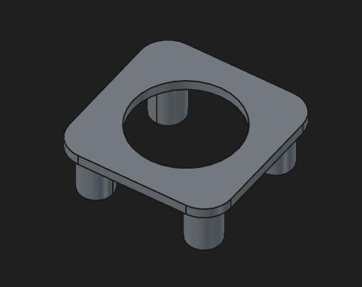
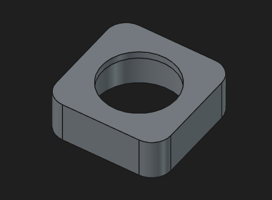
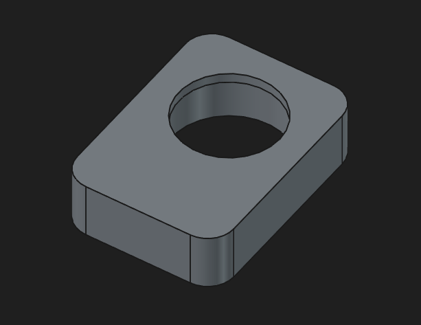
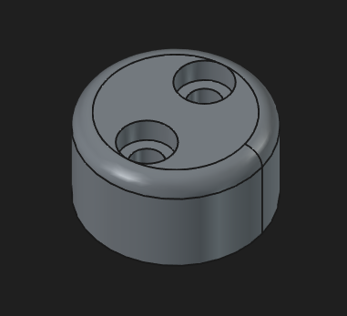
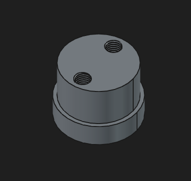
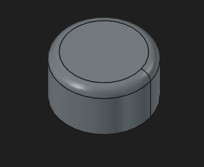
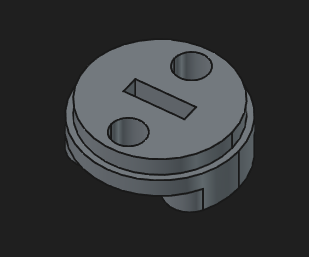

# Magnetic Encoder 3D Files
These 3d prints are required for the magnetic encoder to have something to read. There are a few different types of base, shaft, and top. All the bases are compatible with all of the shaft and top types, but the knob shaft and knob top types need to match. Knob Top is only compatible with Knob Shaft, and Knob Top 2 is only compatible with Knob Shaft 2, but Knob Base, Knob Base 2, and Knob Base 3 are compatible with both sets of tops and shafts.

I have included the .FDStd file (open with FreeCAD to edit) where they are all instantiated. For ease of 3d printing, I have also provided all the components as individual .step files.

Knob Shaft 2 is shaped as it is to make support removal a bit easier for 3d printing, but wave overhangs also work well with its current geometry.

