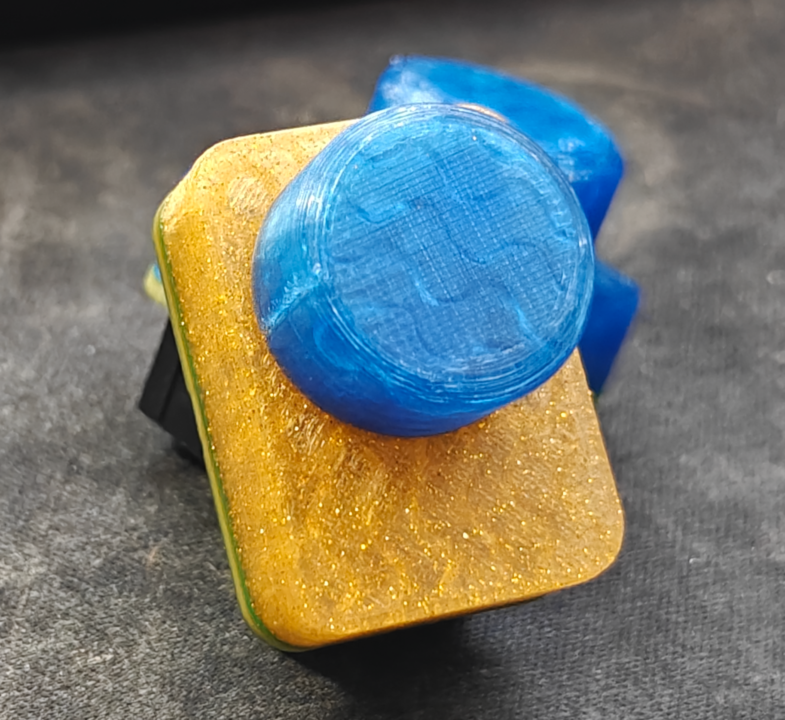

# Magnetic Encoder SAO Supercon 2026
This repo contains the information necessary for building and 3d printing the accessories for the magnetic encoder SAO I brought to Hackaday Supercon 2026

## Magnetic Encoder SAO Assembled

## Hardware Required
This project requires 6 M3 screws (I recommend 4x6mm and 2x8mm (the longer ones for the knob)) and a small (6mm diameter, 1.8mm thickness) neodymium magnet that is inserted into the knob before it's screwed together. Additionally, it requires 3 3d-printed components: a base, a knob top, and a knob shaft.
They make magnets that are magnetized radially, and many of the off-the-shelf magnetic encoder boards use those, but I had a difficult time sourcing those. I've found that it's much easier to just use the axially-magnetized neodymium magnets you can get from anywhere and design the 3d print around them like I've done here.

## Electronics Required
I have included the KiCad project in this repository, but this project requires the AS5600 8-pin ASOT or ASOM (the AS5600L uses a PWM output instead of the analog output, so it will also work, but it's not a direct replacement), 0805 resistors (2x4.7kohm and 1x330 ohm), 0805 capacitors (1x1uF and 1x100nF), an SAO connector (good options  are the SSK05-BH-254-B3 and the Wurth Elektronik 61200621621 (which I am convinced from physical comparison are the same part from the same manufacturer)), and an optional 20mmx20mm Neopixel (also known as WS2812 LEDs). The Neopixel is technically out of spec, as the datasheet says the lowest voltage it supports is 3.7V, but I have had success at the SAO standard 3.3V.
